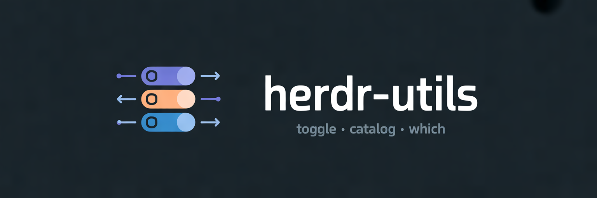

<p align="center">
  
</p>

<!-- Restore the badges with the first tag: they need a workflow run to point at.
[](https://github.com/WilberC/herdr-utils/actions/workflows/ci.yml)
[](https://github.com/WilberC/herdr-utils/actions/workflows/release.yml)
-->
[](LICENSE)

**Small, toggleable utilities for [herdr](https://herdr.dev)** — one Go binary
(`hu`) plugging into herdr's plugin surface. Every tool is off until you turn it
on, so installing the container changes nothing.

## What it solves

- **Keybindings you cannot remember** — `hu which` is a keybinding guide built
  for herdr: your `hs` actions, your gentle-shell commands, your own entries and
  the actions installed plugins declare, one searchable screen instead of four
  config files. Open it from the `herdr-utils.which` action; bind it to a key.
- **Plugins you meant to install** — a curated catalog of recommended herdr
  plugins, rendered in this README and installable on a new machine with one
  command. The catalog is the repository's `plugins.toml`, never a hand-edited
  section.
- **Containers that decide for you** — nothing is on by default. `tools.which`
  and `tools.plugins` each have their own switch, and so does every source the
  guide renders, so the tool is only ever what you asked for.

## Quick start

```bash
herdr plugin install WilberC/herdr-utils   # fetch the plugin; its build hook provisions bin/hu
hu plugins sync                            # installs the recommended plugins this catalog declares
```

The plugin config lives in the herdr plugin config directory —
`$HERDR_PLUGIN_CONFIG_DIR/config.json`, otherwise
`$XDG_CONFIG_HOME/herdr/plugins/config/herdr-utils/config.json`. Enable what you
want and leave the rest off:

```json
{
  "tools": {"which": true, "plugins": false},
  "which": {"sources": {"hs": true, "gentle": true, "custom": false, "discovered": false}}
}
```

Then bind the action herdr declares, and `prefix+i` opens the guide:

```toml
[[keys.command]]
key = "prefix+i"
type = "plugin_action"
command = "herdr-utils.which"
```

Every step has its own section: [Install](docs/install.md), [The keybinding
guide](docs/which.md) and [Recommended plugins](docs/plugins.md).

## Recommended plugins

<!-- generated:recommended start -->
Install the core entries with `hu plugins sync`; add `--optional` to include the optional ones.

| Plugin | Why | Kind |
| --- | --- | --- |
| [`speardragon/herdr-plugin-manager`](https://github.com/speardragon/herdr-plugin-manager) | Plugin management TUI | core |
| [`jeffarese/herdr-bar`](https://github.com/jeffarese/herdr-bar) | Command bar with focus history and agent icons | core |
| [`WilberC/herdr-suite`](https://github.com/WilberC/herdr-suite) | Sessions, space layout snapshot/restore and focus-history toggles | core |
| [`lmilojevicc/herdr-last`](https://github.com/lmilojevicc/herdr-last) | Previous workspace and tab toggle daemon | optional |
| [`ramarivera/herdr-pretty-which`](https://github.com/ramarivera/herdr-pretty-which) | Keybinding guide beta; needs a Rust toolchain | optional |
<!-- generated:recommended end -->

## Cheatsheet

| Command | Does | Detail |
| --- | --- | --- |
| `hu which` | open the keybinding guide | [which](docs/which.md) |
| `hu plugins list` | catalog plugins against this machine's installs | [plugins](docs/plugins.md) |
| `hu plugins sync` | install the missing catalog plugins (`--dry-run`, `--json`, `--optional`) | [plugins](docs/plugins.md) |
| `hu startup` | apply the config gate; herdr runs this at server start | [health](docs/health.md#the-startup-gate) |
| `hu version` | the release this binary was built as | [health](docs/health.md#version) |
| `hu version --check` | compare the binary with the manifest beside it | [health](docs/health.md#version) |

Every behavior above is covered by offline tests — the herdr surface is a fake in
tests, so no test ever touches a socket — and every release binary is
smoke-tested by the release workflow itself.

## Documentation

| Document | Covers |
| --- | --- |
| [Install](docs/install.md) | plugin install, the manual binary download and its checksum, the `[[build]]` hook |
| [Which](docs/which.md) | the keybinding guide, its four sources, its toggles and the `prefix+i` binding |
| [Plugins](docs/plugins.md) | the catalog, `hu plugins list` and `sync`, and why the README section is generated |
| [Health](docs/health.md) | `hu version`, the startup gate, the config file and the exit codes |
| [Development](docs/development.md) | offline tests, `make` targets, the workflows, the release flow and the repository layout |

## Status

This release line ships the container, its config toggles, the startup gate, the
`which` action and the plugin catalog. The guide's screen lands in the same
release line; until then `hu which` prints its usage and exits 2, which no script
mistakes for success.

## License

[MIT](LICENSE).

Contributing: [CONTRIBUTING.md](CONTRIBUTING.md) · Changes:
[CHANGELOG.md](CHANGELOG.md) · Security:
[.github/SECURITY.md](.github/SECURITY.md) · Development:
[docs/development.md](docs/development.md).
